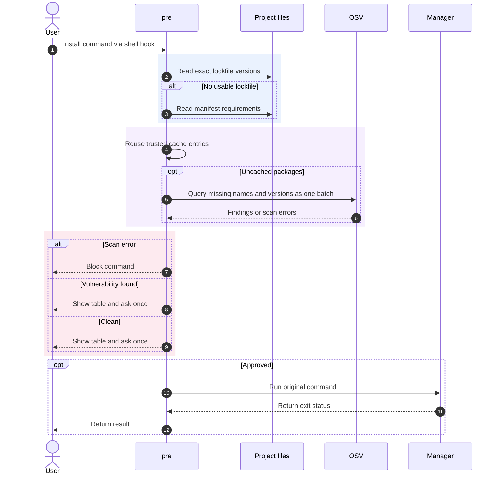
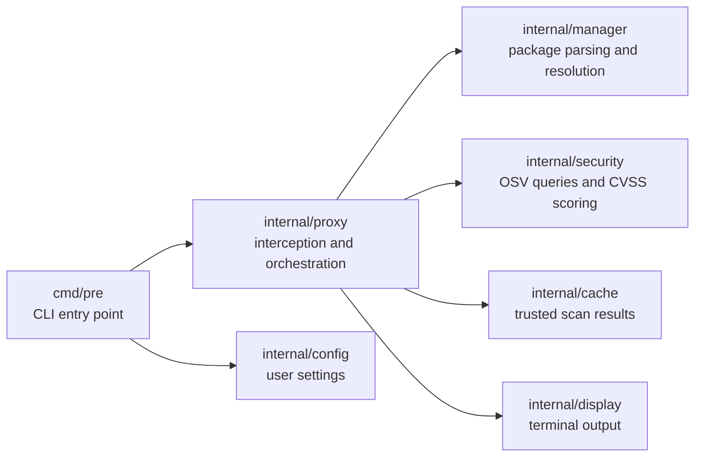

# pre≋≈~∿

`pre` checks packages against [OSV](https://osv.dev) before your package manager installs them.

[](https://github.com/yowainwright/pre/actions/workflows/test.yml)
[](https://github.com/yowainwright/pre/releases)
[](LICENSE)

Works with brew, npm, pnpm, Bun, Go, Cargo, pip/pip3, uv, and Poetry.

## Install

### Homebrew

<!-- Installation matches the formula PR published by .github/workflows/release.yml. -->

```sh
brew install --formula yowainwright/tap/pre
```

For macOS and Linux. To switch from the old cask:

```sh
brew uninstall --cask yowainwright/tap/pre
brew install --formula yowainwright/tap/pre
```

### Curl

For macOS and Linux; requires `cosign` on `PATH`.

```sh
curl -fsSL https://raw.githubusercontent.com/yowainwright/pre/main/install.sh | sh
```

The installer verifies SHA-256 checksums and their Cosign signature before installing. Failed verification stops the install.

## Setup

<!-- Shell hook setup and automatic refresh from internal/proxy/setup.go. -->

```sh
pre setup
```

Setup writes `shell-hook.sh` beside your config. Your `~/.zshrc` or `~/.bashrc` sources that file. Restart your shell once to load the hooks.

Scripts can call `pre <manager> ...` directly.

Existing shell hooks migrate automatically. After upgrades, open terminals reload them at the next prompt.

With hooks enabled, a successful `brew update` also upgrades Pre in the background.

Example output (Zsh):

```text
pre: added hooks to /home/user/.zshrc
pre: restart your shell or run: source /home/user/.zshrc
```

[Check status](#pre-status) or [remove the hooks](#pre-teardown).

## Emergency controls

### Bypass one command

```sh
PRE_DISABLE=1 npm install react
```

### Bypass the current session

```sh
export PRE_DISABLE=1
```

To remove interception permanently, [remove the hooks](#pre-teardown) or [uninstall pre](#pre-self-uninstall).

### Bypass the cache for one install

```sh
PRE_CACHE_TTL=0s npm install
```

### Hide clean scan output

```sh
PRE_QUIET=1 npm install
```

### Runtime switches

| Env var | What it does |
|---------|--------------|
| `PRE_DISABLE=1` | Bypasses all `pre` scans and runs the package manager directly |
| `PRE_QUIET=1` | Hides scan progress and clean summaries; vulnerabilities and errors still print |
| `PRE_MAX_PACKAGES=N` | Blocks installs that expand beyond `N` packages; manual `pre scan system` skips instead |
| `PRE_CACHE_MAX_ENTRIES=N` | Prunes the approval cache to at most `N` entries |
| `PRE_CACHE_MAX_BYTES=N` | Prunes the approval cache to at most `N` bytes |
| `PRE_OBS=0` | Disables local obs event recording |
| `PRE_OBS_DIR=PATH` | Writes obs events to an alternate local state directory |

## How it works



1. Read exact versions from the lockfile, or resolve the requested versions.
2. Check uncached packages against OSV.
3. Show the results and ask before installing.

Cached approvals proceed silently. Failed scans or unresolved versions block installation. Use `PRE_DISABLE=1` to bypass scanning.

### Resolution limits

- npm sources must use `https://registry.npmjs.org` and match the lockfile package identity. Aliases, links, local files, tarballs, and custom registries are blocked.
- Cargo supports crates.io releases, not local/Git dependencies, alternate registries, offline resolution, or resolution-changing configuration and unstable options. `--config` and `--lockfile-path` are blocked.
- Workspace-wide `cargo fetch` needs a shared `Cargo.lock`; create it with `cargo generate-lockfile` first.
- `uv sync` and lockfile-wide Poetry commands need existing lockfiles. Create them with `uv lock` or `poetry lock` first.

## CLI API

### `pre teardown`

Remove the [shell hooks](#setup), then restart your shell.

```sh
pre teardown
```

Example output (Zsh):

```text
pre: removed hooks from /home/user/.zshrc
pre: restart your shell or run: source /home/user/.zshrc
```

### `pre status`

Show the install location, config path, managers, cache size, and last manual system scan.

```sh
pre status
```

Example output (excerpt):

```text
cached: 2 packages
system scan: no manual scan yet
```

### `pre manage`

Browse and manage installed packages. Alias: `pre m`.

```sh
pre manage
```

| Key | Action |
|-----|--------|
| `↑` / `↓` or `j` / `k` | Move between packages |
| `/` | Search as you type |
| `m` | Toggle managers |
| `enter` or `o` | Open package actions |
| `x` or `esc` | Close a dialog |
| `q` or `ctrl+c` | Exit |

Themes: `PRE_MANAGE_THEME=contrast` for brighter colors or `PRE_MANAGE_THEME=mono` for no color. Pre scans installs and downgrades first.

`uv` targets the active environment with `uv pip`; Cargo actions edit project dependencies.

### `--upgrade`

Upgrade from the command line. Omit the version to resolve an upgrade.

```sh
pre manage --package react --manager npm --upgrade 19.0.0
```

Example `package.json` change:

```diff
 {
   "dependencies": {
-    "react": "^18.2.0",
+    "react": "^19.0.0",
     "zod": "^3.24.1"
   }
 }
```

### `--downgrade`

Install an older version from the command line.

```sh
pre manage --package react --manager npm --downgrade 18.2.0
```

Example `package.json` change:

```diff
 {
   "dependencies": {
-    "react": "^19.0.0",
+    "react": "^18.2.0",
     "zod": "^3.24.1"
   }
 }
```

### `--uninstall`

Uninstall from the command line.

```sh
pre manage --package react --manager npm --uninstall
```

Example `package.json` change:

```diff
 {
   "dependencies": {
-    "react": "^18.2.0",
     "zod": "^3.24.1"
   }
 }
```

### `pre installed`

List installed packages across detected managers.

```sh
pre installed
```

Example output:

```text
installed packages:
    1  npm      react                                18.2.0
    2  npm      zod                                  3.24.1
```

### `pre install`

Scan a package, then install it with the named manager after approval.

```sh
pre install npm react@18.2.0
```

Example `package.json` change:

```diff
 {
   "dependencies": {
+    "react": "^18.2.0",
     "zod": "^3.24.1"
   }
 }
```

### `pre update`

Update a package. Omit the package for a manager-wide update. Pre blocks updates it cannot resolve to exact versions.

```sh
pre update npm react
```

Example `package.json` change (the resolved version varies):

```diff
 {
   "dependencies": {
-    "react": "^18.2.0",
+    "react": "^19.0.0",
     "zod": "^3.24.1"
   }
 }
```

### `pre downgrade`

Install an older package version.

```sh
pre downgrade npm react 18.2.0
```

Example `package.json` change:

```diff
 {
   "dependencies": {
-    "react": "^19.0.0",
+    "react": "^18.2.0",
     "zod": "^3.24.1"
   }
 }
```

### `pre uninstall`

Remove a package with the named manager.

```sh
pre uninstall npm react
```

Example `package.json` change:

```diff
 {
   "dependencies": {
-    "react": "^18.2.0",
     "zod": "^3.24.1"
   }
 }
```

### `pre config`

Show the API endpoint and cache TTL.

```sh
pre config
```

Default output:

```text
api.endpoint  https://api.osv.dev/v1/query
cache.ttl     24h
```

### `pre config set`

Set `api.endpoint` or `cache.ttl`. [pre status](#pre-status) shows the config file's location.

```sh
pre config set cache.ttl 12h
```

Example `config.json` change (excerpt):

```diff
 {
   "cache": {
-    "ttl": "24h"
+    "ttl": "12h"
   }
 }
```

#### Custom managers

Add a manager in `config.json`. Use a built-in name to override it.

Example `config.json` change (excerpt):

```diff
 {
-  "managers": []
+  "managers": [
+    {
+      "name": "composer",
+      "ecosystem": "Packagist",
+      "installCmds": ["install", "require"]
+    }
+  ]
 }
```

### `pre obs`

Inspect cache, process, and scan activity.

```sh
pre obs
```

Example output (excerpt):

```text
process:
  background: none
scans:
  allowed: 2
  blocked: 1
  failed: 0
```

Logs stay local and rotate automatically. By default, they omit command arguments, paths, environment variables, and package names.

#### `--json`

Get JSON output.

```sh
pre obs --json
```

Example output (excerpt):

```json
{
  "scans": {
    "allowed": 2,
    "blocked": 1,
    "failed": 0
  }
}
```

### `--events`

Filter events by text. Omit the query to list all events.

```sh
pre obs --events scan
```

Example output:

```text
  - 2026-09-07T12:00:00Z pre.scan.completed
  - 2026-09-07T12:00:01Z pre.scan.approved
```

### `pre scan system`

Scan only the packages in Pre's cache. View results with [pre status](#pre-status).

```sh
pre scan system
```

Example `pre status` change after a successful scan:

```diff
-system scan: no manual scan yet
+system scan: 2 total · 0 crit · 0 warn · last run 2026-09-07 12:00
```

### `pre self update`

Update `pre` through Homebrew or the verified curl installer. Curl/manual installs require `cosign` on `PATH`.

```sh
pre self update
```

Example progress output (Homebrew):

```text
pre: updating with Homebrew
```

### `pre self uninstall`

Remove shell hooks and `pre` itself. Add `--purge` to also remove config and cache data.

```sh
pre self uninstall
```

Example output (manual install):

```text
pre: removed hooks from /home/user/.zshrc
pre: removed binary /usr/local/bin/pre
```

## Security model

- Sends package names and versions to [OSV](https://osv.dev).
- Uses lockfiles to check exact transitive versions before installation.
- Blocks installs when scanning, version resolution, or project reading fails.
- Asks before installing packages without a cached approval.
- Keeps troubleshooting logs local.
- Signs release checksums with keyless Cosign. The curl installer requires successful verification.

Pre checks known vulnerabilities. Keep lockfiles, review dependency changes, and audit dependencies in CI.

## Agent skill

Agent instructions: [skills/pre/SKILL.md](skills/pre/SKILL.md).

## Runtime architecture



## Repository layout

```text
cmd/pre/           CLI dispatch, lifecycle, package management, and screenshots
internal/manager/  Package-manager definitions, manifests, lockfiles, and versions
internal/proxy/    Command interception, scanning, shell hooks, and rendering
internal/security/ OSV client and severity scoring
scripts/           Setup and release automation
skills/pre/        Agent skill
tests/e2e/          Go and Docker package-manager tests
tests/integration/  Live-service tests
tests/scripts/      Shell tests
```

Ecosystem-specific files use `<capability>_<ecosystem>.go`. Unit tests live beside
their source and use matching filenames; `tests/` is reserved for cross-process
and live-service coverage. The root `install.sh` remains the public curl-install
entry point packaged with each release.

## Development

Read [AGENTS.md](AGENTS.md) before making changes.

### Setup

Install the pinned tools and repository hooks:

```sh
make setup
```

### Unit tests

```sh
make test
```

### CLI and shell E2E tests

<!-- CLI and shell E2E coverage from tests/e2e/pre_test.go and Makefile. -->

Requires Bash and Zsh. Tests setup, migration, interception, teardown, and live upgrades with compiled binaries.

```sh
make test-e2e
```

### Lint

Check formatting, Go, and shell code:

```sh
make lint
```

More checks: [Makefile](Makefile).

### Release validation

<!-- Release flow and commands from Makefile and .github/workflows/release.yml. -->

Preview a release locally with `make release-preview`. To check the artifacts:

```sh
make release-check
make snapshot
make verify-release-binary
```

Snapshot checks verify checksums for the installer and all four platform binaries. Smoke tests check the host binary's version and default config on macOS and Linux.

Stable releases open a Homebrew tap PR with `Formula/pre.rb` and `brews/pre.json`. Tap CI audits, installs, and tests the formula. The Homebrew update is available after the PR merges. Prereleases leave the stable formula unchanged.

`HOMEBREW_TAP_TOKEN` needs **Contents: read and write** and **Pull requests: read and write** on `yowainwright/homebrew-tap`.

If only the Homebrew job fails, rerun that job in GitHub Actions.

## Docker E2E tests

Requires Docker. Each scenario checks clean packages, known CVEs, and blocked installs through the shell hooks.

### List scenarios

```sh
make test-e2e-list
```

### npm scenario

```sh
make test-e2e-docker E2E_TEST=npm
```

### pip scenario

```sh
make test-e2e-docker E2E_TEST=pip
```

## License

MIT
